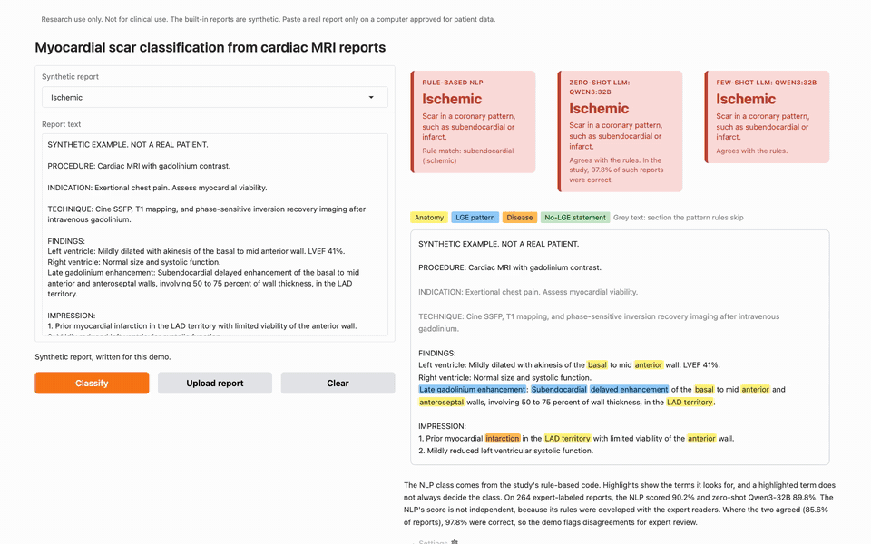

# ScarText

**Classify myocardial scar patterns from free-text cardiac MRI reports** — ischemic, non-ischemic, mixed, no-scar or not-specified — with a rule-based NLP pipeline and open-weight LLMs that run on your own computer.

[](https://huggingface.co/spaces/tavakolineda/ScarText) [](https://colab.research.google.com/github/NedaTavakoli/ScarText/blob/main/notebooks/quickstart.ipynb)

Code for the paper **"ScarText: Can Large Language Models Match Expert Rules in Classifying Myocardial Scar Patterns from Cardiac MRI Reports?"** (Tavakoli N, Rahsepar AA, Ozturk O, Bagci U, Lee DC, Kim D; under review).

**Research use only. Not for clinical use.**

## What's in this repository

| Folder | What it is | Who it is for |
|---|---|---|
| [`scartext/`](scartext) | **The tool.** A small Python package: `classify_scar` (rules), `classify_llm` (local LLM), `compare`, `analyze_csv`, `extract_lvef`, `explain`, `show_report` | Anyone who wants to classify their own reports |
| [`notebooks/`](notebooks) | `quickstart.ipynb`: a step-by-step tour that runs in Google Colab | First-time users |
| [`demo/`](demo) | A local web app showing the rules and an LLM side by side | Anyone who wants to try it with a browser |
| [`examples/synthetic_reports/`](examples/synthetic_reports) | Six made-up reports, one per class plus a negated no-scar wording | Testing |
| [`paper_scripts/`](paper_scripts) | The paper's original research scripts (rules, every LLM, few-shot, pool-size curves, order test), unchanged in logic | Reviewers and anyone reproducing the paper |

In short: **use `scartext/`; read `paper_scripts/` to see exactly how the paper's numbers were produced.** No patient data are included anywhere.

## Demo

[](demo/CMR_scar_demo_synthetic.mp4)

Each report is shown with three results side by side: the rule-based NLP, zero-shot Qwen3-32B and few-shot Qwen3-32B. Where an LLM agrees with the rules the report is accepted; where it disagrees, it is flagged for expert review. All reports shown are synthetic. [Watch the full video (36 s)](demo/CMR_scar_demo_synthetic.mp4).

**Try it online:** the [live demo](https://huggingface.co/spaces/tavakolineda/ScarText) classifies any report you paste or upload (.txt or .docx) with the rule-based NLP and highlights the terms it uses. It runs the rules and zero-shot Qwen3-32B on Hugging Face's shared GPUs; the other LLMs and few-shot prompting run on your own computer (below). Do not upload identifiable patient information.

## Quick start

**In the browser:** open the [quickstart notebook in Colab](https://colab.research.google.com/github/NedaTavakoli/ScarText/blob/main/notebooks/quickstart.ipynb).

**On your computer** (Python 3.9 or newer):

```bash
git clone https://github.com/NedaTavakoli/ScarText.git
cd ScarText
pip install -e .          # installs the scartext package; keep the folder, the package reads the paper's rules from paper_scripts/
```

```python
from scartext import classify_scar

classify_scar("Late gadolinium enhancement: subendocardial scar of the inferior wall in the RCA territory.")   # 'ischemic'
```

## Using the ScarText package

`scartext` is a small Python package that wraps the paper's code, so you can classify your own reports in a few lines. The rule-based classifier needs nothing else; the LLM functions need [Ollama](https://ollama.com) running on your own computer (next section).

| Function | What it does | Returns |
|---|---|---|
| `classify_scar(text)` | The paper's rule-based NLP: no GPU, same answer every time | one of `CLASSES`, or `None` if the rules exclude the report (cardiac device, no contrast, no LGE description) |
| `explain(text)` | The rule-based class and why | a dict: `label`, `reason`, `ischemic_evidence`, `nonischemic_evidence`, `scar_mentioned` |
| `extract_lvef(text)` | Left ventricular ejection fraction stated in the report | a number in percent, or `None` |
| `classify_llm(text, model="qwen3:32b", examples=None)` | A local LLM with the paper's prompt and settings; few-shot when you pass labeled examples | one of `CLASSES`, or `None` if the answer could not be read |
| `compare(rule_label, llm_label)` | The paper's agreement check | `'agree'` (accept the class), `'review'` (send to an expert) or `'rules only'` (no LLM answer) |
| `analyze_csv(path, text_column, out_path=None, model=None)` | Classifies every report in a CSV column | a table with new columns `scar_rules`, `lvef` and, with a model, `scar_llm` and `decision` |
| `show_report(text)` | Shows the report in a notebook with the terms the rules use highlighted | (display) |
| `ollama_available()` | Lists the models your Ollama server offers | a list of model names (`[]` if Ollama is not running) |

`CLASSES` is `('ischemic', 'non-ischemic', 'mixed', 'no-scar', 'not-specified')`.

**1. One report with the rules** (no GPU):

```python
from scartext import classify_scar, explain, extract_lvef

text = open("examples/synthetic_reports/mixed.txt").read()
classify_scar(text)     # 'mixed'
explain(text)           # {'label': 'mixed', 'reason': 'mixed (ischemic + non-ischemic)', 'ischemic_evidence': True, ...}
extract_lvef(text)      # 32.0
```

**2. Add a local LLM as a second reader** (needs Ollama and a model, see below):

```python
from scartext import classify_llm, compare, ollama_available

ollama_available()                              # e.g. ['gpt-oss:20b', 'qwen3:32b']
llm = classify_llm(text, model="gpt-oss:20b")   # e.g. 'mixed'
compare(classify_scar(text), llm)               # 'agree' -> accept; 'review' -> send to an expert
```

**3. A whole file of reports:**

```python
from scartext import analyze_csv

table = analyze_csv("reports.csv", text_column="report_text", out_path="classified.csv")   # rules only
table = analyze_csv("reports.csv", text_column="report_text", model="gpt-oss:20b")          # rules + LLM + decision
```

**4. Few-shot with your own labeled reports:** pass a table with columns `report_text` and `gold_label`; for each report, the five most similar labeled reports (one per class first) go into the prompt, as in the paper. In the paper, 10 to 100 labeled reports brought the largest models to the accuracy of the rules.

```python
import pandas as pd
labeled = pd.read_csv("my_labeled_reports.csv")          # columns: report_text, gold_label
classify_llm(text, model="qwen3:32b", examples=labeled)
```

**5. In a notebook:** `show_report(text)` displays the report with the rule-based class and the highlighted terms. The [quickstart notebook](notebooks/quickstart.ipynb) walks through all of the above, and runs in Colab.

Do not put identifiable patient information into shared notebooks or online tools. Everything above runs on your own computer.

## Using the LLMs: no data leave your computer

The LLMs are **public open-weight models used without training**, so there is no private checkpoint: you download the same models the paper used and run them locally with [Ollama](https://ollama.com).

| Model | Download | Paper accuracy (zero-shot, 264 reports) | Hardware |
|---|---|---|---|
| gpt-oss-20b (OpenAI, open-weight; runs locally, unlike cloud GPT-4) | `ollama pull gpt-oss:20b` (~13 GB; needs a recent Ollama) | 90.9% | GPU with ≥16 GB, or a Mac with ≥24 GB; about 2 s per report |
| Qwen3-32B (Alibaba) | `ollama pull qwen3:32b` (~20 GB) | 89.8% | GPU with ≥24 GB, or a Mac with ≥32 GB |
| Llama-3.1-70B (Meta) | `ollama pull llama3.1:70b` (~43 GB) | 88.3% | ≥48 GB |
| Llama-3.3-70B (Meta) | `ollama pull llama3.3:70b` (~43 GB) | 87.9% | ≥48 GB |
| MedGemma-27B (Google) | `ollama pull medgemma:27b` (~17 GB; needs a recent Ollama) | 84.5% | GPU with ≥24 GB |
| Llama-3.1-8B (Meta) | `ollama pull llama3.1:8b` (~5 GB) | 79.2% | a laptop, or free Colab |

Two further models from the paper are not offered by `classify_llm` because they were less accurate and do not run through Ollama: MedGemma-4B-IT (Google, 57.2%) and Flan-T5-base (Google, at most 20.8%). Their scripts are in `paper_scripts/` (see *Reproducing the paper*).

**Setting up Ollama:** install it from [ollama.com](https://ollama.com), start it (`ollama serve`, or open the app), and download a model, for example `ollama pull gpt-oss:20b`. gpt-oss-20b and MedGemma-27B need a recent Ollama version.

gpt-oss-20b reasons before it answers; `classify_llm` runs it at its lowest reasoning level with a 4,096-token output cap, as in the paper.

`classify_llm` talks to Ollama at `http://127.0.0.1:11434` on your own machine (change it with `host=` or `OLLAMA_HOST_URL`). The model weights are not redistributed here and keep their own licenses (Llama 3.1 and 3.3 Community Licenses; Apache 2.0 for Qwen3 and gpt-oss; Health AI Developer Foundations terms for MedGemma).

**Few-shot:** pass your own labeled reports, `classify_llm(text, model=..., examples=df)` with columns `report_text` and `gold_label`; five similar examples, one per class first, are put in each prompt, as in the paper. The paper's expert-labeled reports are not distributed.

## Main results

Correct classifications against an expert cardiothoracic radiologist (two blinded readers, κ = 0.995). Zero-shot: no labeled examples; few-shot: five labeled example reports in each prompt, tested on 66 held-out reports.

| Method | Zero-shot, 264 reports | Zero-shot, 66 held-out | Few-shot (5 examples), 66 held-out | Time per report |
|---|---|---|---|---|
| **Rule-based NLP** | **238 (90.2%)** | 61 (92.4%) | (rules: 61, 92.4%) | 0.006 s on a CPU |
| gpt-oss-20b (OpenAI) | 240 (90.9%) | 59 (89.4%) | 60 (90.9%) | 2.0 s |
| Qwen3-32B (Alibaba) | 237 (89.8%) | 59 (89.4%) | 63 (95.5%) | 12.2 s |
| Llama-3.1-70B (Meta) | 233 (88.3%) | 57 (86.4%) | 60 (90.9%) | 11.5 s |
| Llama-3.3-70B (Meta) | 232 (87.9%) | 59 (89.4%) | 61 (92.4%) | 12.6 s |
| MedGemma-27B (Google) | 223 (84.5%) | 53 (80.3%) | 58 (87.9%) | 7.2 s |
| Llama-3.1-8B (Meta) | 209 (79.2%) | 51 (77.3%) | 46 (69.7%) | 1.8 s |
| MedGemma-4B-IT (Google) | 151 (57.2%) | 36 (54.5%) | 39 (59.1%) | 7.3 s |
| Flan-T5-base (Google), impression only | 55 (20.8%) | 14 (21.2%) | not run (input too short) | 0.1 s |

LLM times are on one NVIDIA A40 GPU. gpt-oss-20b, Qwen3-32B, Llama-3.1-70B and Llama-3.3-70B did not differ from the rules; Llama-3.3-70B, gpt-oss-20b and MedGemma-27B were added after the main analysis. Where the rules and zero-shot Qwen3-32B agreed (85.6% of reports), 97.8% were correct, and their disagreements held 21 of the 26 rule errors, which is why the package offers `compare` for a rules-first, LLM-as-second-reader workflow.

The rules were derived by a cardiologist and two cardiothoracic radiologists, and their accuracy was measured against the radiologists' blinded labels.

## Reproducing the paper

Every model in the paper has its script in `paper_scripts/`. The tool (`classify_llm`) offers the Ollama models, which matched the rules; MedGemma-4B-IT and Flan-T5-base ran through Hugging Face Transformers in the paper and are kept as research scripts.

| Model | Runner in the paper | Script | Zero-shot accuracy (264 reports) |
|---|---|---|---|
| Rule-based NLP | Python / PySpark (CPU) | `paper_scripts/cardiac_mri_nlp_5class.py` | 90.2% |
| Qwen3-32B | Ollama | `paper_scripts/cardiac_mri_llm_5class.py`, `paper_scripts/rerun_llm_expert264.py` | 89.8% |
| Llama-3.1-70B | Ollama | same | 88.3% |
| Llama-3.1-8B | Ollama | same | 79.2% |
| Llama-3.3-70B | Ollama | same | 87.9% |
| gpt-oss-20b | Ollama (recent version) | same, with `--think low --num_predict 4096` | 90.9% |
| MedGemma-27B | Ollama (recent version) | same | 84.5% |
| MedGemma-4B-IT | Hugging Face Transformers, 4-bit NF4 (needs accepting Google's terms for `google/medgemma-4b-it`) | `paper_scripts/cardiac_mri_medgemma_fewshot.py` | 57.2% |
| Flan-T5-base | Hugging Face Transformers (512-token input) | `paper_scripts/cardiac_mri_flanT5_5class.py` | ≤20.8% |
| Few-shot (k=5), all Ollama models and MedGemma-4B-IT | as above | `paper_scripts/cardiac_mri_llm_fewshot_all.py`, `paper_scripts/fewshot_curve.py`, `paper_scripts/fewshot_order_test.py` | see the paper |

The scripts read the study's reports, which are not distributed; point `CMR_DATA_DIR` at your own data.

## Settings that matter

The paper found that deployment settings changed LLM accuracy as much as model size. The code sets them explicitly: Ollama context window 8,192 tokens (the default is shorter than many reports plus the prompt); temperature 0 and seed 42; Qwen3 reasoning off; failed or unreadable answers recorded as **missing**, never as a class; and no keyword rule changing the model's answer.

## Data

The study used 37,869 LGE cardiac MRI reports (2005–2025) from Northwestern Medicine. The reports, expert labels and model outputs contain protected health information and are **not distributed**. Everything in this repository runs on synthetic reports; the research scripts in `paper_scripts/` read study data from the folder set by `CMR_DATA_DIR`.

## Citation

See `CITATION.cff`. [Authors: add the DOI when the paper is published.]

## License

MIT, see `LICENSE`. The LLM weights are not part of this repository.
